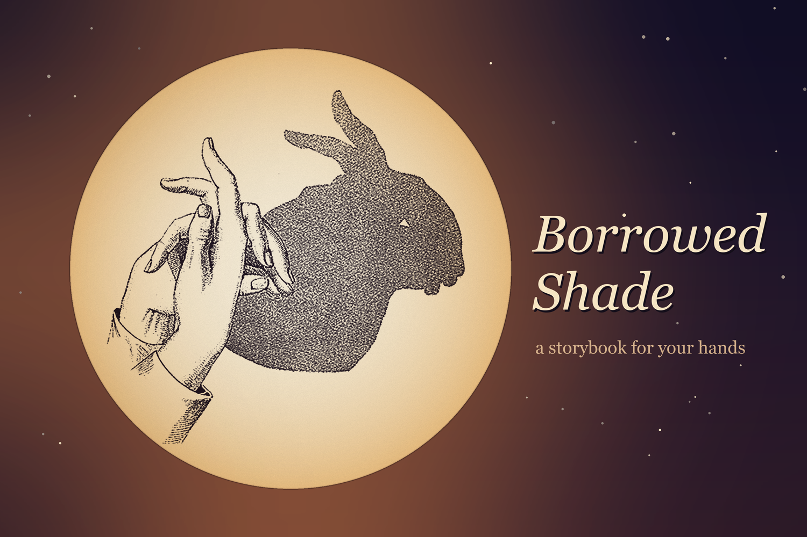
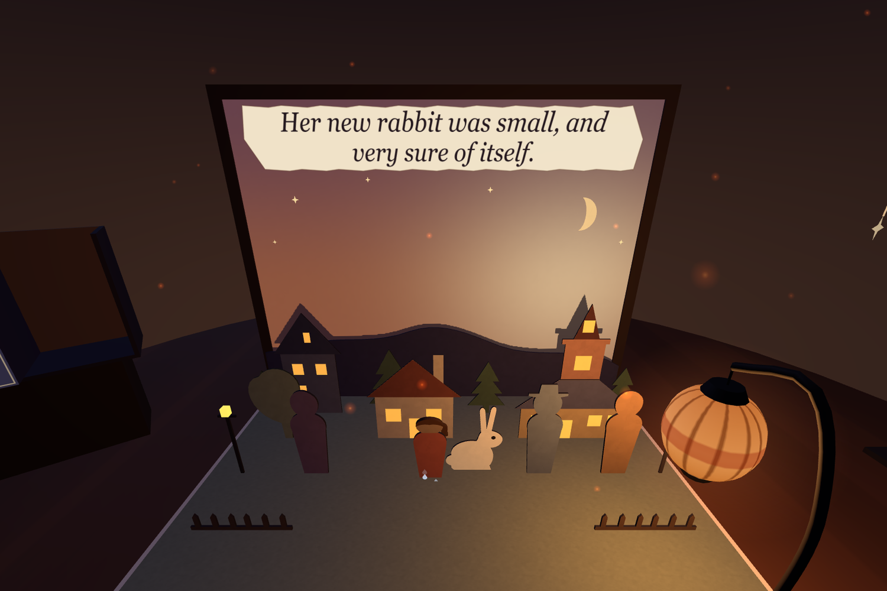
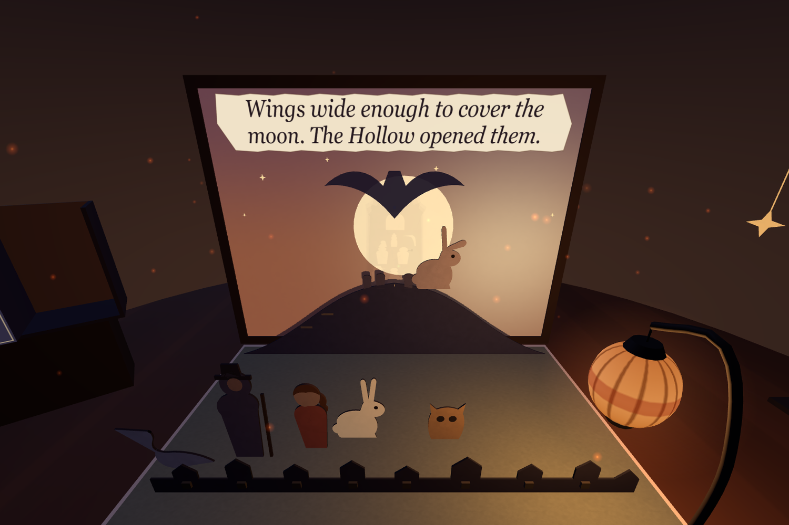
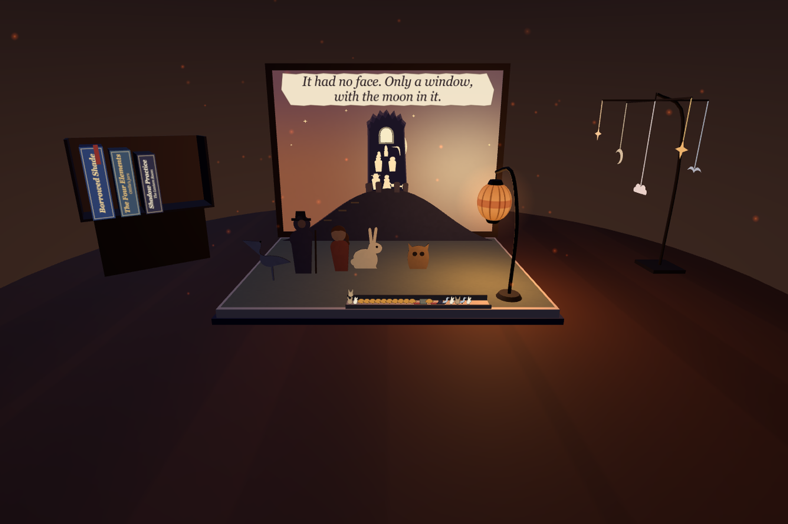
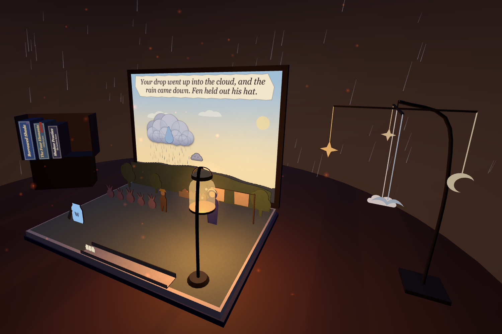
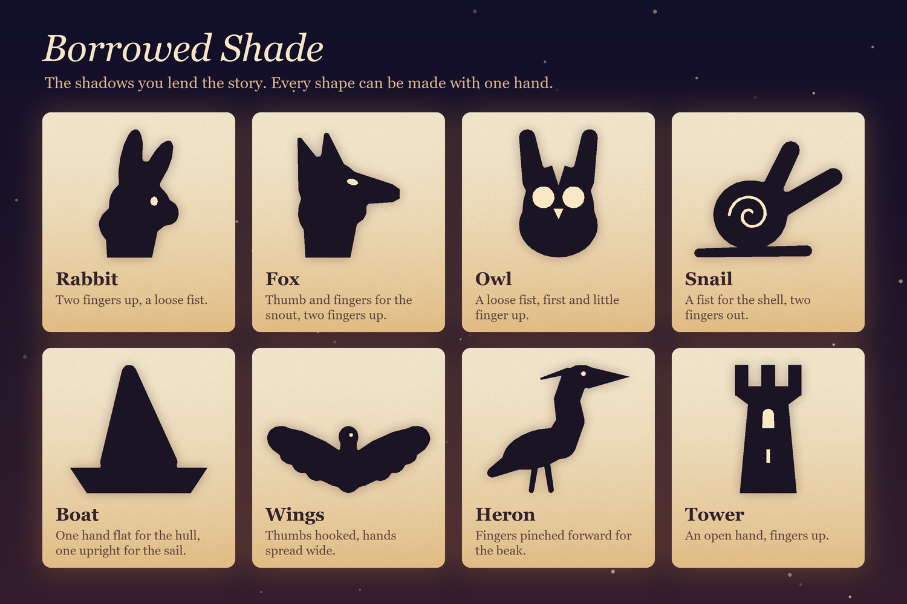
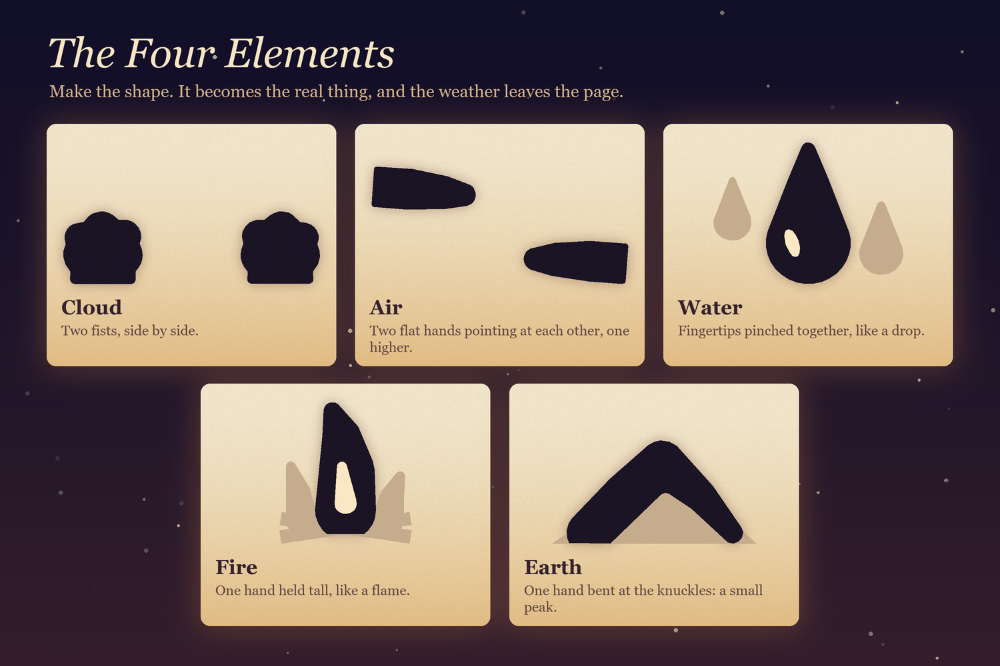

# Borrowed Shade



A pop-up storybook for Meta Quest that you play with nothing but your hands.
Make a rabbit with two fingers, and it steps off the screen and into the story.

**Play it:** [borrowedshade.com](https://www.borrowedshade.com/) (open it in the Quest Browser)

**Watch it:** [the demo video on YouTube](https://www.youtube.com/watch?v=1twNoS-0xJ0)

Built for the Meta VR Start Developer Competition 2026 (Entertainment track).

## The idea

Early 2000s. The power goes out. Somebody lights a candle, and suddenly the most
interesting thing in the house is the wall. You make a rabbit. Then the lights
come back, and it's gone.

That always felt a bit unfair. So this is a book where the shadows stay.

## What's inside

A paper book opens on the table in front of you, in a dark little theatre or, if you
like, on your real table at home. A small lantern lights a paper screen, and your
hands throw real shadows on it. No controllers at any point.

There are three books on the shelf:

- **Borrowed Shade**, the main tale. A village has lost its shadows and you lend
  yours to get them back. Two roads, two endings.
- **The Four Elements**. Your hands make a cloud, wind, rain, fire and a mountain,
  and the weather doesn't stay politely on the page.
- **Shadow Practice**. No story, just play. Hold a hand still and birds land on it.

| | |
|---|---|
|  |  |
|  |  |

## The shadows





## How to play

You need a Meta Quest with hand tracking, and a table to sit at.

1. Open [borrowedshade.com](https://www.borrowedshade.com/) in the Quest Browser and tap Begin.
2. Put the controllers down. The book appears on the table in front of you.
3. Touch the cover to open it.

On the desk:

- **Page corner** (front left): touch the glowing corner to turn the page.
- **Lantern** (front right): hold a flat hand over it to pause. Settings live there too.
- **Shelf** (back left): touch a spine to pick another book.
- **Mobile** (back right): it earns a new piece each time you finish something. Poke it.
- **Your real room**: it starts in a dark theatre. In the lantern menu, set Room to Auto
  and your real room shows through. If your table is marked in the Quest's Space Setup,
  the book settles right onto it.

When the story asks for a shape, hold your hand in the lantern's light so its
shadow fills the outline on the screen. The wax seal shows how close you are.
At 75 it's yours.

## Nobody gets left out in the dark

- Every two-hand shape has a one-hand version.
- You can't lose. The book helps a little, then a little more, then makes the
  shape for you and admits it.
- You sit the whole time. If your arms get tired, put them down. The book waits.
- Text size, a slower pace and a stronger caption ribbon are in the lantern menu.

## How it works

The shadows are real. Your tracked hand is drawn from the lantern's point of view
onto the screen, the same way a candle does it. That shadow is then compared with
the outline the story is hoping for, and the fit becomes the number on the seal.

Almost everything else is paper, cut and folded in code: the houses, the puppets,
the layers that stand up when a page turns. The music is generated live too. Each
character you make joins in with its own instrument.

## Run it yourself

You need Node 20.19 or newer.

```bash
npm install
npm run quest
```

This builds the game and serves it on your local network over https. Open the
`Network` address it prints in the Quest Browser (accept the certificate warning
once). For a quick look on a desktop browser, `npm run dev` works too.

## Built with

- [Immersive Web SDK](https://www.npmjs.com/package/@iwsdk/core) and WebXR
- [three.js](https://threejs.org/)
- TypeScript and Vite

## Credits

Made by Gokhan Ceylan. Third-party material is listed in [CREDITS.md](CREDITS.md).
